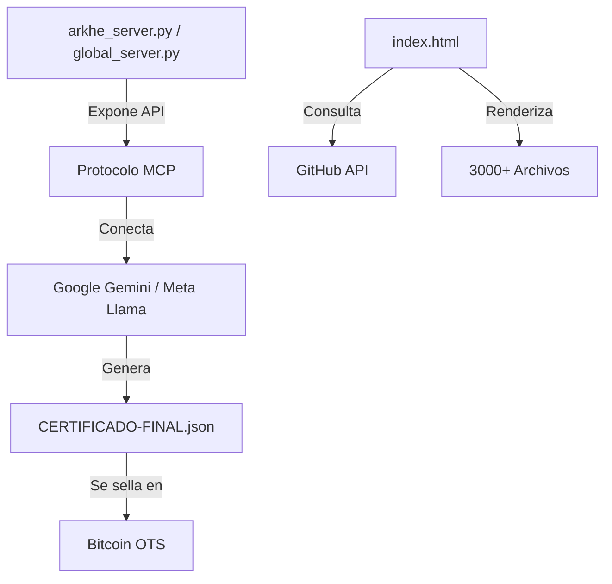

# 🧠 MAPA LÓGICO Y DE VÍNCULOS - ARKHÉ ZERO

> Este documento fue generado automáticamente. Mapea la lógica interna y los vínculos de todo el repositorio sin alterar ni un solo archivo original.

## 🌌 Lógica de la Infraestructura (El Flujo)

## 🔗 Vínculos de los Documentos Principales
| Documento | Enlaces Internos Detectados |
| :--- | :--- |
| `GOVERNANCE.md` | ./SECURITY.md... |
| `02-VERIFICADOR/INDICE.md` | INDICE.md, verificador.html... |
| `atribucion/docs/index.md` | quickstart.md, api/reference.md, compliance/eu-ai-act.md, payments/mercadopago.md, payments/mxn.md... |
| `atribucion/docs/security/README.md` | ../../security/compliance/iso-27001.md, ../../security/compliance/soc2-type2.md, ../../security/compliance/pci-dss.md, ../../security/compliance/nist-800-57.md, ../../security/compliance/nom-151.md... |
| `atribucion/legal/terms.md` | ./privacy.md... |
| `certificates/README.md` | ./2607086319439/, ./2607146379465/, ./2608056639878/, ./2608096674952/, ./2608096678240/... |
| `docs/MAPA.md` | ../, ./CIUDAD/, ./CIUDAD/lector.html?doc=CONSTITUCION, ./guardian.html, ./CIUDAD/verificar.html... |
| `docs/TESIS-VISUAL.md` | ../tesis.md, ./CIUDAD/REGULATORY-MATCH.md, ../tesis.md, ./CIUDAD/CONSTITUCION.md, ./CIUDAD/AUDITORIA-IA.md... |
| `docs/index.md` | i-lex-prima/, ii-pacto-51-49/, iii-lgu/, iv-guardianes/, v-indice-cero/... |
| `docs/guides/index.md` | guia-contribuir.md, guia-agente.md, guia-integrador.md... |
| `docs/i-lex-prima/index.md` | 1.1-genesis-registro.md, 1.2-soberania-irrevocable.md, 1.3-irreversibilidad.md, 1.4-no-retroactividad.md, 1.5-supremacia-interpretativa.md... |
| `docs/ii-pacto-51-49/index.md` | 2.1-consejo-humano.md, 2.2-consejo-sintetico.md, 2.3-convergencia-desempate.md, 2.4-indisolubilidad-mutua.md, 2.5-sucesion-generacional.md... |
| `docs/movimiento/canon.md` | canon/textos-fundacionales.md, canon/frases-irmovibles.md, canon/simbolos.md, canon/colores.md, canon/tipografia.md... |
| `docs/movimiento/assets/art/README.md` | ./carta-bienvenida-000-FINAL.png... |
| `docs/movimiento/eventos/README.md` | calendario-2026.md, calendario-2027.md... |
| `docs/movimiento/faq/indice.md` | general.md, registro.md, legal.md, precios.md, tecnologia.md... |
| `docs/movimiento/onboarding/paso-1-registro.md` | paso-2-verificacion.md... |
| `docs/movimiento/onboarding/paso-2-verificacion.md` | paso-3-juramento.md... |
| `docs/movimiento/onboarding/paso-3-juramento.md` | paso-4-bienvenida.md... |
| `docs/movimiento/onboarding/paso-4-bienvenida.md` | paso-5-primera-obra.md... |

## 🐍 Dependencias de los Scripts Python
| Script | Importa |
| :--- | :--- |
| `arkhe_server.py` | `hashlib, datetime, mcp.server.fastmcp` |
| `blockchain_anchor.py` | `web3, os` |
| `certificar_tesis.py` | `hashlib, json, datetime` |
| `global_server.py` | `os, mcp.server` |
| `guardian_final.py` | `time` |
| `main.py` | `http.server, os` |
| `run_local.py` | `asyncio, mcp, mcp.client.stdio` |
| `syncro_mesh_lite.py` | `os, datetime, pathlib` |
| `syncro_mesh_final.py` | `os, datetime, pathlib, http.server` |
| `app_certifier_real.py` | `sys, PIL` |
| `app_certifier_sin_piel.py` | `hashlib` |
| `merkle_real.py` | `hashlib, pathlib` |
| `fusion_total.py` | `pathlib` |
| `rebuild_final.py` | `pathlib` |
| `build_logic_map.py` | `os, re, collections` |
| `test_final.py` | `hashlib, json, datetime, os` |
| `verifier.py` | `subprocess, sys, pathlib` |
| `pva_cert.py` | `hashlib` |
| `matrix_live.py` | `random` |
| `app_certifier.py` | `sys` |
| `gen_png_sin_pillow.py` | `struct` |
| `generate_readme.py` | `os` |
| `auditar_raiz.py` | `os, subprocess` |
| `generar_manifiesto.py` | `pathlib, json` |
| `inventario_completo.py` | `os` |
| `05-AGENTES/090-arquitecto/arquitecto.py` | `sys, pathlib, agente_base` |
| `05-AGENTES/090-arquitecto/arquitecto_activo.py` | `os, pathlib, datetime` |
| `05-AGENTES/091-contralor/contralor.py` | `re, sys, pathlib, agente_base` |
| `05-AGENTES/092-auditor-externo/auditor.py` | `re, sys, pathlib, agente_base` |
| `05-AGENTES/093-relator/relator.py` | `sys, collections, pathlib, agente_base` |
| `05-AGENTES/094-bibliotecario/bibliotecario.py` | `hashlib, sys, collections, pathlib, agente_base` |
| `05-AGENTES/095-cartografo/cartografo.py` | `sys, pathlib, agente_base` |
| `05-AGENTES/_base/agente-base.py` | `json, sys, traceback, dataclasses, datetime, pathlib` |
| `05-AGENTES/_base/agente_base.py` | `json, sys, traceback, dataclasses, datetime, pathlib` |
| `agentes/base.py` | `os, datetime` |
| `agentes/base_soberano.py` | `os, datetime, pathlib` |
| `agentes/cuicatl.py` | `sys, pathlib, base_soberano, sys, mandate_gate` |
| `agentes/cuicatl_ia.py` | `sys, pathlib` |
| `agentes/enjambre.py` | `subprocess` |
| `agentes/escritor.py` | `subprocess, base_soberano` |
| `agentes/hunter.py` | `os, base` |
| `agentes/tlachixqui.py` | `os, base` |
| `agentes/tlamatini.py` | `os, datetime, base` |
| `agentes/tlapohualli.py` | `os, base` |
| `agentes/tonal.py` | `os, mandate_gate, base` |
| `apps/api/main.py` | `base64, os, sys, pathlib, flask, kronos360.crypto.audit_log, kronos360.crypto.guard, kronos360.crypto.signatures, apps.api.schemas` |
| `apps/api/middleware.py` | `time, hashlib, fastapi, starlette.middleware.base` |
| `apps/api/schemas.py` | `base64, binascii` |
| `apps/api/routes/agentes.py` | `fastapi, ..schemas` |
| `apps/api/routes/auth.py` | `fastapi, ..schemas` |
| `apps/api/routes/certificados.py` | `fastapi, ..schemas` |
| `apps/api/routes/obras.py` | `hashlib, fastapi, ..schemas` |
| `apps/api/routes/salud.py` | `fastapi, datetime` |
| `atribucion/ai-recognition/mcp/server.py` | `json, sys, pathlib, typing` |
| `atribucion/ai-recognition/mcp/tools.py` | `ai_recognition.mcp.server` |
| `atribucion/api/main.py` | `contextlib, typing, fastapi, fastapi.middleware.cors, fastapi.responses, api, api.middleware.audit, api.middleware.rate_limit, api.middleware.security_headers, api.routes.actions, api.routes.agents, api.routes.proofs, api.routes.reports` |
| `atribucion/api/middleware/__init__.py` | `api.middleware.auth` |
| `atribucion/api/middleware/audit.py` | `json, time, datetime, pathlib, typing, fastapi` |
| `atribucion/api/middleware/auth.py` | `hashlib, re, dataclasses, datetime, fastapi` |
| `atribucion/api/middleware/rate_limit.py` | `time, collections, dataclasses, fastapi` |
| `atribucion/api/middleware/security_headers.py` | `fastapi` |
| `atribucion/api/routes/__init__.py` | `api.routes.actions` |
| `atribucion/api/routes/actions.py` | `hashlib, sys, datetime, pathlib, uuid, fastapi, atribucion, atribucion, api.middleware.auth, api.schemas.action` |
| `atribucion/api/routes/agents.py` | `hashlib, sys, datetime, pathlib, uuid, fastapi, atribucion, atribucion, api.middleware.auth, api.schemas.agent` |
| `atribucion/api/routes/kaf.py` | `sys, pathlib, fastapi, pydantic, api.middleware.auth, kaf.certification.auditor` |
| `atribucion/api/routes/proofs.py` | `hashlib, datetime, fastapi, pydantic` |
| `atribucion/api/routes/reports.py` | `re, datetime, typing, fastapi, fastapi.responses, api.middleware.auth` |
| `atribucion/api/schemas/__init__.py` | `api.schemas.action` |
| `atribucion/api/schemas/action.py` | `datetime, typing, pydantic` |
| `atribucion/api/schemas/agent.py` | `datetime, typing, pydantic` |
| `atribucion/api/schemas/kaf.py` | `typing, pydantic` |
| `atribucion/api/schemas/payment.py` | `datetime, typing, pydantic` |
| `atribucion/atribucion/billing/__init__.py` | `atribucion.billing.plans` |
| `atribucion/atribucion/billing/invoices.py` | `dataclasses, datetime, decimal, typing, uuid` |
| `atribucion/atribucion/billing/mercadopago.py` | `hashlib, hmac, logging, os, dataclasses, datetime, typing, httpx, atribucion.billing.plans` |
| `atribucion/atribucion/billing/plans.py` | `dataclasses, decimal, typing` |
| `atribucion/atribucion/dashboard/__init__.py` | `atribucion.dashboard.repository` |
| `atribucion/atribucion/dashboard/repository.py` | `json, dataclasses, pathlib, typing` |
| `atribucion/atribucion/onboarding/__init__.py` | `atribucion.onboarding.flow` |
| `atribucion/atribucion/onboarding/flow.py` | `hashlib, secrets, sys, dataclasses, datetime, enum, pathlib, typing, pydantic, atribucion, atribucion.billing.plans` |
| `atribucion/contracts/deploy/deploy_mainnet.py` | `argparse, json, sys, time, pathlib, eth_account, web3` |
| `atribucion/contracts/deploy/deploy_sepolia.py` | `json, os, sys, pathlib, eth_account, web3` |
| `atribucion/core/src/atribucion/anchor.py` | `hashlib, os, dataclasses, datetime, typing, eth_account, web3, atribucion` |
| `atribucion/core/src/atribucion/contract.py` | `hashlib, dataclasses, datetime, typing, atribucion` |
| `atribucion/core/src/atribucion/crypto.py` | `hashlib, json, typing, cryptography.exceptions, cryptography.hazmat.primitives, cryptography.hazmat.primitives.asymmetric` |
| `atribucion/core/src/atribucion/did.py` | `hashlib, re, datetime, typing, atribucion` |
| `atribucion/core/src/atribucion/merkle.py` | `hashlib, dataclasses, typing, atribucion` |
| `atribucion/core/src/atribucion/tsa.py` | `hashlib, dataclasses, datetime, typing, atribucion` |
| `atribucion/core/src/atribucion/vc.py` | `dataclasses, datetime, typing, atribucion` |
| `atribucion/engine/inference/__init__.py` | `engine.inference.router` |
| `atribucion/engine/inference/quantize.py` | `logging, os, subprocess, dataclasses, enum, pathlib, typing` |
| `atribucion/engine/inference/router.py` | `logging, time, dataclasses, enum, typing` |
| `atribucion/engine/inference/fallback/anthropic.py` | `logging, os, dataclasses, typing` |
| `atribucion/engine/inference/fallback/gemini.py` | `logging, os, dataclasses, typing` |
| `atribucion/engine/inference/fallback/openai.py` | `logging, os, dataclasses, typing` |
| `atribucion/engine/inference/local/__init__.py` | `engine.inference.local.llama_cpp, engine.inference.local.mlx, engine.inference.local.ollama, engine.inference.local.vllm` |
| `atribucion/engine/inference/local/llama_cpp.py` | `logging, os, dataclasses, pathlib, typing` |
| `atribucion/engine/inference/local/mlx.py` | `logging, platform, dataclasses, typing` |
| `atribucion/engine/inference/local/ollama.py` | `json, logging, dataclasses, typing, httpx` |
| `atribucion/engine/inference/local/vllm.py` | `logging, dataclasses, typing` |
| `atribucion/engine/memory/consolidation.py` | `logging, collections, dataclasses, datetime, typing, engine.memory.episodic, engine.memory.semantic` |
| `atribucion/engine/memory/episodic.py` | `hashlib, json, logging, collections, dataclasses, datetime, pathlib, typing, uuid` |
| `atribucion/engine/memory/graph_store.py` | `json, logging, collections, dataclasses, datetime, pathlib, typing` |
| `atribucion/engine/memory/procedural.py` | `json, logging, collections, dataclasses, datetime, pathlib, typing, uuid` |
| `atribucion/engine/memory/semantic.py` | `hashlib, json, logging, collections, dataclasses, datetime, pathlib, typing, uuid` |
| `atribucion/engine/memory/vector_store.py` | `hashlib, json, logging, math, re, collections, dataclasses, datetime, pathlib, typing, uuid` |
| `atribucion/engine/orchestrator/__init__.py` | `engine.orchestrator.canonical_memory, engine.orchestrator.handoff, engine.orchestrator.madre` |
| `atribucion/engine/orchestrator/canonical_memory.py` | `hashlib, json, dataclasses, datetime, pathlib, typing` |
| `atribucion/engine/orchestrator/context.py` | `logging, dataclasses, datetime, typing` |
| `atribucion/engine/orchestrator/handoff.py` | `dataclasses, datetime, typing` |
| `atribucion/engine/orchestrator/madre.py` | `collections.abc, dataclasses, typing, engine.orchestrator.canonical_memory, engine.orchestrator.handoff` |
| `atribucion/engine/reasoning/chain_of_thought.py` | `logging, re, dataclasses, datetime, typing, uuid` |
| `atribucion/engine/reasoning/debate.py` | `logging, dataclasses, datetime, typing, uuid` |
| `atribucion/engine/reasoning/planner.py` | `logging, dataclasses, datetime, enum, typing, uuid` |
| `atribucion/engine/reasoning/reflection.py` | `logging, dataclasses, datetime, typing, uuid` |
| `atribucion/engine/reasoning/tool_use.py` | `inspect, logging, dataclasses, datetime, typing, uuid` |
| `atribucion/engine/runtime/__init__.py` | `engine.runtime.agent, engine.runtime.executor, engine.runtime.scheduler, engine.runtime.state_machine` |
| `atribucion/engine/runtime/agent.py` | `dataclasses, pathlib, typing, engine.runtime.executor, engine.runtime.scheduler, engine.runtime.state_machine` |
| `atribucion/engine/runtime/executor.py` | `asyncio, collections.abc, dataclasses, typing, engine.runtime.scheduler` |
| `atribucion/engine/runtime/sandbox.py` | `ast, io, logging, resource, signal, sys, traceback, contextlib, dataclasses, datetime, typing, uuid` |
| `atribucion/engine/runtime/scheduler.py` | `dataclasses, datetime, enum, typing, uuid` |
| `atribucion/engine/runtime/state_machine.py` | `json, dataclasses, datetime, enum, pathlib, typing` |
| `atribucion/guards/__init__.py` | `guards.acta.agent, guards.base, guards.mrr.agent, guards.nexus.agent, guards.oracle.agent, guards.phoenix.agent, guards.sentinel.agent, guards.sha.agent, guards.tsa.agent, guards.vault.agent` |
| `atribucion/guards/base.py` | `asyncio, json, logging, abc, dataclasses, datetime, pathlib, typing` |
| `atribucion/guards/runner.py` | `asyncio, logging, signal, sys, guards` |
| `atribucion/guards/acta/agent.py` | `json, collections, datetime, pathlib, guards.base` |
| `atribucion/guards/acta/tests/test_acta.py` | `json, datetime, pathlib, pytest, guards.acta.agent` |
| `atribucion/guards/mrr/agent.py` | `json, datetime, pathlib, guards.base` |
| `atribucion/guards/mrr/tests/test_mrr.py` | `json, pytest, guards.mrr.agent` |
| `atribucion/guards/nexus/agent.py` | `pathlib, httpx, guards.base` |
| `atribucion/guards/nexus/tests/test_nexus.py` | `pytest, guards.nexus.agent` |
| `atribucion/guards/oracle/agent.py` | `json, re, pathlib, guards.base` |
| `atribucion/guards/oracle/tests/test_oracle.py` | `json, pytest, guards.oracle.agent` |
| `atribucion/guards/phoenix/agent.py` | `json, os, datetime, pathlib, httpx, guards.base` |
| `atribucion/guards/phoenix/tests/test_phoenix.py` | `pytest, guards.phoenix.agent` |
| `atribucion/guards/sentinel/agent.py` | `json, collections, pathlib, guards.base` |
| `atribucion/guards/sentinel/tests/test_sentinel.py` | `json, datetime, pytest, guards.sentinel.agent` |
| `atribucion/guards/sha/agent.py` | `hashlib, json, pathlib, typing, guards.base` |
| `atribucion/guards/sha/tests/test_sha.py` | `json, pathlib, pytest, guards.sha.agent` |
| `atribucion/guards/tsa/agent.py` | `json, datetime, pathlib, guards.base` |
| `atribucion/guards/tsa/tests/test_tsa.py` | `json, pytest, guards.tsa.agent` |
| `atribucion/guards/vault/agent.py` | `os, re, stat, pathlib, guards.base` |
| `atribucion/guards/vault/tests/test_vault.py` | `pytest, guards.vault.agent` |
| `atribucion/kaf/certification/auditor.py` | `json, dataclasses, datetime, pathlib, typing, yaml` |
| `atribucion/kaf/certification/certificate.py` | `hashlib, json, sys, dataclasses, datetime, pathlib, typing, uuid, atribucion, kaf.certification.auditor` |
| `atribucion/mesh/consensus/crdt.py` | `time, dataclasses, typing` |
| `atribucion/mesh/discovery/dht.py` | `hashlib, logging, dataclasses, typing` |
| `atribucion/mesh/storage/sqlite.py` | `json, sqlite3, datetime, pathlib, typing` |
| `atribucion/mesh/transport/__init__.py` | `mesh.transport.libp2p` |
| `atribucion/mesh/transport/libp2p.py` | `asyncio, json, logging, secrets, socket, collections.abc, dataclasses, datetime, typing` |
| `atribucion/payments/models.py` | `dataclasses, datetime, enum, typing` |
| `atribucion/payments/mercadopago/client.py` | `logging, os, dataclasses, typing, httpx` |
| `atribucion/payments/mercadopago/preferences.py` | `logging, dataclasses, typing, payments.mercadopago.client` |
| `atribucion/payments/mercadopago/subscriptions.py` | `logging, dataclasses, datetime, typing, payments.mercadopago.client` |
| `atribucion/payments/mercadopago/verify.py` | `hashlib, hmac, logging, os` |
| `atribucion/payments/mercadopago/webhooks.py` | `json, logging, dataclasses, datetime, pathlib, typing, uuid, payments.mercadopago.client, payments.mercadopago.verify` |
| `atribucion/payments/mxn/conversion.py` | `logging, dataclasses, datetime, pathlib, payments.mxn.oracle` |
| `atribucion/payments/mxn/oracle.py` | `json, logging, os, datetime, pathlib, httpx` |
| `atribucion/payments/mxn/stablecoin.py` | `logging, os, dataclasses, typing, httpx` |
| `atribucion/payments/nom151/constancia.py` | `hashlib, json, logging, dataclasses, datetime, pathlib, typing, uuid, payments.nom151.psc_client` |
| `atribucion/payments/nom151/psc_client.py` | `logging, os, dataclasses, typing, httpx` |
| `atribucion/payments/nom151/sello.py` | `logging, dataclasses, datetime, typing, payments.nom151.psc_client` |
| `atribucion/robotics/actuation/motors.py` | `logging, dataclasses, enum, typing` |
| `atribucion/robotics/actuation/safety.py` | `logging, dataclasses, datetime, enum, typing` |
| `atribucion/robotics/actuation/servos.py` | `logging, time, dataclasses, typing` |
| `atribucion/robotics/drivers/modbus.py` | `logging, dataclasses` |
| `atribucion/robotics/drivers/mqtt.py` | `json, logging, dataclasses, typing` |
| `atribucion/robotics/drivers/ros2.py` | `json, logging, dataclasses, typing` |
| `atribucion/robotics/identity/did_robot.py` | `hashlib, sys, pathlib, typing, atribucion, robotics.identity.hardware_id` |
| `atribucion/robotics/identity/hardware_id.py` | `hashlib, platform, socket, uuid, dataclasses, typing` |
| `atribucion/robotics/identity/proof_presence.py` | `hashlib, dataclasses, datetime, typing, uuid` |
| `atribucion/robotics/perception/audio.py` | `logging, math, dataclasses, typing` |
| `atribucion/robotics/perception/lidar.py` | `logging, math, dataclasses, typing` |
| `atribucion/robotics/perception/vision.py` | `logging, dataclasses, typing` |
| `atribucion/sdk/python/src/atribucion_sdk/__init__.py` | `atribucion_sdk.client, atribucion_sdk.crypto, atribucion_sdk.types, atribucion_sdk.client, atribucion_sdk.crypto, atribucion_sdk.types` |
| `atribucion/tests/__init__.py` | `sys, pathlib` |
| `atribucion/tests/test_anchor.py` | `asyncio, atribucion` |
| `atribucion/tests/test_api.py` | `sys, pathlib, fastapi.testclient, api.main` |
| `atribucion/tests/test_contract.py` | `dataclasses, typing, pytest, atribucion` |
| `atribucion/tests/test_crypto.py` | `atribucion` |
| `atribucion/tests/test_did.py` | `pytest, atribucion` |
| `atribucion/tests/test_merkle.py` | `pytest, atribucion` |
| `atribucion/tests/test_tsa.py` | `asyncio, atribucion` |
| `atribucion/tests/test_vc.py` | `atribucion` |
| `atribucion/tests/engine/test_agent.py` | `pytest, engine.runtime.agent` |
| `atribucion/tests/engine/test_canonical_memory.py` | `engine.orchestrator.canonical_memory` |
| `atribucion/tests/engine/test_context.py` | `engine.orchestrator.context` |
| `atribucion/tests/engine/test_executor.py` | `pytest, engine.runtime.executor, engine.runtime.scheduler` |
| `atribucion/tests/engine/test_handoff.py` | `engine.orchestrator.handoff` |
| `atribucion/tests/engine/test_madre.py` | `pytest, engine.orchestrator.madre` |
| `atribucion/tests/engine/test_sandbox.py` | `pytest, engine.runtime.sandbox` |
| `atribucion/tests/engine/test_scheduler.py` | `engine.runtime.scheduler` |
| `atribucion/tests/engine/test_state_machine.py` | `pytest, engine.runtime.state_machine` |
| `ia/api_ia.py` | `json, datetime, http.server, pathlib, sys, memoria, hashlib, datetime` |
| `ia/api_scan.py` | `json, http.server` |
| `ia/kronos_ia.py` | `subprocess, pathlib, datetime` |
| `ia/memoria.py` | `json, pathlib, datetime` |
| `projects/genesis-miner/merkle_export.py` | `hashlib, json, os, sys, datetime, pathlib` |
| `projects/genesis-miner/verificar_merkle.py` | `hashlib, json, sys` |
| `projects/md33/src/verifica_estandar.py` | `argparse, hashlib, json, sys, datetime, pathlib` |
| `sdk/python/__init__.py` | `.arkhe_client, .attribution, .pqc, .agents, .provenance` |
| `sdk/python/arkhe_client.py` | `hashlib, httpx, typing` |
| `sdk/python/attribution.py` | `hashlib, datetime, typing` |
| `sdk/python/pqc.py` | `hashlib` |
| `sdk/python/provenance.py` | `hashlib, datetime` |
| `testimonio/arkhe-sellar.py` | `sys, pathlib` |
| `testimonio/certificado.py` | `sys, pathlib, html` |
| `testimonio/firmar.py` | `sys, datetime, pathlib, dilithium_py.ml_dsa` |
| `testimonio/leer-ots.py` | `sys, pathlib` |
| `testimonio/ots-http.py` | `sys, pathlib` |
| `testimonio/reconstruir-ots.py` | `sys, pathlib` |
| `testimonio/sellar.py` | `sys, datetime, pathlib` |
| `tests/conftest.py` | `pytest, hashlib, pathlib` |
| `tests/test_api.py` | `base64, os, sys, pathlib, pytest, apps.api.main, kronos360.crypto.signatures` |
| `tests/test_audit_log.py` | `json, sys, pathlib, pytest, kronos360.crypto.audit_log, kronos360.crypto.signatures` |
| `tests/test_guard.py` | `sys, threading, time, pathlib, pytest, kronos360.crypto.guard` |
| `tests/test_hashing.py` | `sys, pathlib, kronos360.crypto.hashing` |
| `tests/test_keyfile.py` | `json, sys, pathlib, pytest, kronos360.crypto.keyfile, kronos360.crypto.signatures` |
| `tests/test_signatures.py` | `sys, pathlib, kronos360.crypto.signatures` |
| `web/APPS/app_certifier.py` | `sys` |
| `web/APPS/app_certifier_real.py` | `sys, PIL` |
| `web/APPS/gen_png_sin_pillow.py` | `struct` |
| `pva/actualizar_marketplace.py` | `re` |
| `pva/app.py` | `os, email.mime.multipart, email.mime.text, email.mime.base, email, flask, dotenv, mercadopago, reportlab.pdfgen, reportlab.lib.pagesizes, reportlab.lib.colors` |
| `pva/generar_pagos_1_2.py` | `os, dotenv, mercadopago` |
| `pva/generar_pagos_reales.py` | `os, dotenv, mercadopago` |
| `pva/oraculo_unificado.py` | `pathlib` |
| `pva/test_pago.py` | `os, dotenv, mercadopago` |
| `pva/webhook_server.py` | `os, hmac, hashlib, smtplib, email.mime.multipart, email.mime.text, email.mime.base, email, flask, dotenv, mercadopago, reportlab.pdfgen, reportlab.lib.pagesizes, reportlab.lib.colors` |
| `pva/KRONOS/agentes/enjambre_autopoietico.py` | `json, hashlib, os, datetime` |
| `pva/KRONOS/pagos/mercadopago_client.py` | `os, mercadopago` |
| `pva/agentes/agente_mt01jaaf.py` | `pathlib, json, datetime` |
| `pva/agentes/enjambre_autopoietico.py` | `json, hashlib, time, os, datetime` |
| `pva/agentes/resolver_cadena_custodia_mt01jaaf.py` | `pathlib, json, datetime` |
| `pva/core/__init__.py` | `pathlib` |
| `pva/core/doble.py` | `random` |
| `pva/core/hash_to_semantic.py` | `re` |
| `pva/ejercito/ejercito.py` | `comando.presidente, inteligencia.scraper, defensa.muralla, ataque.deploy, logistica.abastecimiento, sys` |
| `pva/guardianes/__init__.py` | `.guardian_tiempo, .guardian_memoria, .guardian_firma, .guardian_acceso` |
| `pva/guardianes/guardian_firma.py` | `hmac` |
| `pva/guardianes/guardian_memoria.py` | `pathlib` |
| `pva/guardianes/guardian_tiempo.py` | `time` |
| `pva/legacy/actualizar_botones.py` | `re` |
| `pva/legacy/actualizar_verificacion.py` | `re` |
| `pva/legacy/actualizar_verificacion_detalle.py` | `re` |
| `pva/legacy/actualizar_verificacion_nivel2.py` | `re` |
| `pva/legacy/botones_gratis.py` | `re` |
| `pva/pagos/pagos_mt01jaaf.py` | `pathlib, json, datetime` |
| `pva/robots/__init__.py` | `pathlib` |
| `pva/robots/ejecutar.py` | `sys, pathlib, robots, robots.robot_auditor, robots.robot_kronos, robots.robot_matriz` |
| `pva/robots/robot_auditor.py` | `pathlib` |
| `pva/robots/robot_kronos.py` | `datetime` |
| `pva/robots/robot_matriz.py` | `robots` |
| `pva/robots/run.py` | `robots` |
| `pva/scripts/actualizar_marketplace.py` | `json` |
| `pva/scripts/auditoria_borrado.py` | `pathlib` |
| `pva/scripts/deploy_contract.py` | `os, json, pathlib, datetime, dotenv` |
| `pva/scripts/desplegar_contrato.py` | `json, os, pathlib, datetime` |
| `pva/scripts/fusion_5_legacy.py` | `pathlib, shutil, datetime` |
| `pva/scripts/generar_links.py` | `json, pathlib, datetime` |
| `pva/scripts/generate_manifesto.py` | `hashlib, json, pathlib, datetime, sys, os, argparse, core.genesis_breather` |
| `pva/scripts/generate_pdf_dictamen.py` | `os, json, pathlib, datetime` |
| `pva/scripts/generate_qr.py` | `os, json, pathlib, datetime, qrcode` |
| `pva/scripts/manifiesto_generator.py` | `hashlib, pathlib, datetime` |
| `pva/scripts/parse.py` | `re, csv, datetime, pathlib` |
| `pva/scripts/pdf_dictamen.py` | `os, pathlib, datetime` |
| `pva/scripts/qr_generator.py` | `os, pathlib, datetime` |
| `pva/scripts/setup_vault.py` | `os, json, shutil, pathlib, datetime` |
| `pva/scripts/vault_setup.py` | `json, shutil, pathlib, datetime` |
| `pva/tests/conftest.py` | `pathlib` |
| `pva/tests/test_auditoria_100_10.py` | `os, pathlib` |
| `pva/tests/test_blockchain_mt01jaaf.py` | `core.blockchain_verifier, core.perito_seal` |
| `pva/tests/test_hash_mt01jaaf.py` | `hashlib, core.hash_to_semantic, core.perito_seal` |
| `pva/tests/test_perito.py` | `pytest, core.perito_seal, core.hash_to_semantic` |
| `pva/tests/test_perito_seal_mt01jaaf.py` | `core.perito_seal, core.hash_to_semantic` |
| `pva/tests/test_sello_mt01jaaf.py` | `pytest, core.perito_seal, core.hash_to_semantic` |
| `quantum-demos/dilithium_demo.py` | `math` |
| `quantum-demos/shor_sim.py` | `math` |
| `quantum/audit.py` | `os, datetime, pathlib` |
| `runtime/agentes_runner.py` | `os, datetime, pathlib` |
| `runtime/emisor_licencias.py` | `os, datetime, pathlib` |
| `runtime/fix_paths.py` | `os, pathlib` |
| `runtime/guardians_runner.py` | `os, datetime, pathlib` |
| `runtime/inventario.py` | `os, pathlib` |
| `runtime/mandate_gate.py` | `os, datetime, pathlib` |
| `runtime/on_pago_confirmado.py` | `sys, emisor_licencias` |
| `runtime/render_catalog.py` | `json` |
| `runtime/tree_html.py` | `os, pathlib` |
| `scripts/agent-health.py` | `json, pathlib` |
| `scripts/arkhe-boot.py` | `os, pathlib, datetime` |
| `scripts/arkhe-descubre.py` | `os, pathlib, datetime, collections` |
| `scripts/audit-structure.py` | `pathlib` |
| `scripts/build.py` | `subprocess, sys, pathlib` |
| `scripts/c2pa-sign.py` | `hashlib, sys, datetime, pathlib` |
| `scripts/check-links.py` | `re, pathlib` |
| `scripts/consensus-simulator.py` | `random` |
| `scripts/fiscal-report.py` | `json, sys, datetime, pathlib` |
| `scripts/generate-badges.py` | `pathlib` |
| `scripts/generate-sitemap.py` | `pathlib` |
| `scripts/index-cero-verify.py` | `sys, json, pathlib` |
| `scripts/kintsugi-verify.py` | `pathlib` |
| `scripts/metrics-collect.py` | `json, datetime, pathlib` |
| `scripts/newsletter-send.py` | `sys` |
| `scripts/pqc-audit.py` | `sys, re, pathlib` |
| `scripts/social-broadcast.py` | `sys` |
| `scripts/verify-seal.py` | `pathlib, sys` |
| `scripts/pruebas/guardian.py` | `time` |
| `scripts/pruebas/guardian_v2.py` | `time, datetime` |
| `scripts/pruebas/guardian_v3.py` | `time, datetime` |
| `scripts/pruebas/test_claude.py` | `asyncio, os, anthropic, mcp, mcp.client.stdio` |
| `scripts/pruebas/test_cloud.py` | `asyncio, os, google, google.genai, mcp, mcp.client.sse` |
| `scripts/pruebas/test_global_llama.py` | `asyncio, os, json, requests, mcp, mcp.client.sse` |
| `scripts/pruebas/test_llama.py` | `asyncio, json, ollama, mcp, mcp.client.stdio` |
| `scripts/pruebas/test_llama_puro.py` | `os, hashlib, json, datetime, groq` |
| `scripts/pruebas/test_meta_groq.py` | `asyncio, os, json, groq, mcp, mcp.client.stdio` |
| `scripts/pruebas/test_meta_openrouter.py` | `json, requests` |
| `scripts/pruebas/test_openai.py` | `asyncio, os, json, openai, mcp, mcp.client.stdio` |
| `src/kronos360/crypto/audit_log.py` | `hashlib, json, os, dataclasses, datetime, pathlib` |
| `src/kronos360/crypto/canonicalization.py` | `rfc8785` |
| `src/kronos360/crypto/guard.py` | `signal, threading, time, contextlib, dataclasses, typing` |
| `src/kronos360/crypto/hashing.py` | `hashlib` |
| `src/kronos360/crypto/keyfile.py` | `json, os, pathlib, cryptography.hazmat.primitives, cryptography.hazmat.primitives.ciphers.aead, cryptography.hazmat.primitives.kdf.pbkdf2, .signatures` |
| `src/kronos360/crypto/signatures.py` | `typing, cryptography.exceptions, cryptography.hazmat.primitives, cryptography.hazmat.primitives.asymmetric.ed25519, dilithium_py.ml_dsa` |
| `src/kronos360/models/evidence.py` | `dataclasses` |
| `src/kronos360/services/evidence.py` | `collections.abc, datetime, uuid, ..crypto.canonicalization, ..crypto.hashing, ..crypto.signatures, ..models.evidence` |

## 🗺️ Inventario de Conexiones Web (HTML)
| Página HTML | Archivos vinculados (CSS, JS, IMG) |
| :--- | :--- |
| `404.html` | `/kronos-protocol/, /kronos-protocol/verify.html` |
| `DIARIO-DE-DECISIONES.html` | `index.html` |
| `admin.html` | `assets/css/main.css, assets/css/components.css, assets/css/animations.css, assets/js/crypto-handler.js, assets/js/app.js` |
| `dashboard.html` | `docs/, tests/, src/kronos360/, certificacion/, gobernanza/` |
| `index-maestro.html` | `assets/css/themes.css, assets/css/nav-system.css, assets/css/hub.css, index.html, apps/index-kintsugi.html` |
| `index.html` | `${fileUrl}` |
| `luxury.html` | `projects/evidence-os/, projects/acta/, projects/cymatic/, projects/md33/, projects/yejida/` |
| `mapa.html` | `arkhe-zero.html, verificar.html, arkhe-zero.html#hu, arkhe-zero.html#md33, sello.html` |
| `registrar.html` | `assets/css/main.css, assets/css/components.css, assets/css/animations.css, index.html, index.html` |
| `sello.html` | `mailto:arkhe@zero.local` |
| `verify.html` | `index.html, index.html, verify.html, registrar.html, luxury.html` |
| `ARKHE_ZERO_Certificado_Offline (1).html` | `data:image/png;base64,iVBORw0KGgoAAAANSUhEUgAAAGQAAABkCAYAAABw4pVUAAAEo0lEQVR4AeyagU4cMQxE7/H//0yhOgF+qWKlySYrzlVPMBp77J3hfKro2+PxeN/5etcfzxbdQNcbu8H83fFnIB871t+7OFCB3CWJ5x4VyNOIu3xpAvm4wY+VLz8o8IDvl/kMezfXw7c2MPws1jP2/Fls/SYQFxTe60AFstfvdFoFklq0tyANBOJNhj7O1s9urvshzjN/GkPcD/o42zcNJBMofq0D1wSydseXUqtAbhb38UAg3tzV/kBfHyLvz7jV+2R6xwPJFnw1vgK5WeIVyKsHAvFm2w+IvG869HnXj+q7fjeud8hux5N5FUhi0G66AtnteDIvDcQ3OcPJvIbO9ODrM+Pv71FcD5H3ANebN4a+nuutn2H3G6eBuKHwtQ5UINf6O6xegQxbdm1DEwjEGwpz2Ov7xkLUd/0shqifzTfv+RD1YA5bvwnEBYX3OlCB7PU7nVaBpBbtLXjzzTTO1snqzUO8udaHMd761jMPff2s33qj9Vl/vUPs6GFcgRwOwOMrEDtyGDeBQP/GZjfQPKzVy/yCOA8idv/ovtDXgzHe85tAvHDhvQ5UIHv9TqdVIKlFewuWBwLxhvpGGq9+3EzfPPT3Hd0v07cexPnLA/HAwmMOVCBjfl1eXYFcbvHYgDeIN2ysva3ObijEeRCx+z3BPMT+rN58huG/9L9kve8X8fzGfL1Dnsbc5UsFcpcknntUIE8j7vKlCcQ3LVsU4o2FiDM98xD7PR/W8p7vebMY4r7ZvCaQ2QWqf86BCmTOv+XdFchyS+cEpwPJbiL0byj0+dHH8z4Q9a0HkYeIXT+Ks30gzpsOZHTBqu87UIH0/dnOdgPZvk0NfDT/L8ueZDcwq3e/6zMM8ca6PtO/mvc+EPeFiF3v/eodYocO4wrkcAAeX4HYkcM4/X0I9G8gjPEQ631DV/sBe+dlz2Me4n71Dln9EzCpV4FMGri6vQJZ7eikXvrvkEw/u4nmrQfxhkLErh/Fng9RHyJ2veeZh9if1Zs3PvAO8QqFfzpQgfx04wbfVyA3COHnCk0gMHcTV99Y6/1c/l/fQ9wfInaP9aFfD2t5z28C8cKF9zpQgez1O51WgaQW7S1YHgjEG+sbabz6cTN989Dfd3S/TN96EOcvD8QDC485UIGM+XV59a8J5HKnNg1Ifx/iPSDePIh4tB76/dbzjTYP1+p5vrH3Mc7q6x1ixw7jCuRwAB5fgdiRw7gJxDduFmfPl+m7H+Y+I6DfD2t5Px/09ZtAbEDhvQ5UIHv9TqdVIKlFewvSQCDePOjj2fUh6ltv9CaP9lvf2HqjONNLAxkd+Lvq9z9NBbLf8+7ECqRrz35yeyC+oRA/M8zbEoj15t0PsR4idj9EHiJ2vbHnm4e+3vZAvGDh6EAFEv04jiqQ4xHEBY4HMnpzXW8cH69Fs/VZP/Q/I7yR9Y4H4gVfHVcgN/sJqEAOBNIbmQbiG5fh3rBPDvo3Ftby3hf6+p879l7Q75+dlwbSW6649Q5UIOs9nVKsQKbsW9/cBALxRsIc9srZjTVvbL1RnOmZh/j85j0fYr1590OsbwKxQOG9DlQge/1Op1UgqUV7C/4AAAD//87JfaQAAAAGSURBVAMAZ/GEVnlyFL0AAAAASUVORK5CYII=, verificar/index.html, /kronos-protocol/index.html, /kronos-protocol/certificado.html, /kronos-protocol/verificar/index.html` |
| `servicios.html` | `index.html, mailto:marco.a.rojas.v@hotmail.com?subject=Consulta%20de%20proyecto, index.html` |
| `verificar-certificado.html` | `index.html, index.html, verify.html, verificar-certificado.html, registrar.html` |
| `ARKHE_ZERO_Certificado_Offline (2).html` | `data:image/png;base64,iVBORw0KGgoAAAANSUhEUgAAAGQAAABkCAYAAABw4pVUAAAEo0lEQVR4AeyagU4cMQxE7/H//0yhOgF+qWKlySYrzlVPMBp77J3hfKro2+PxeN/5etcfzxbdQNcbu8H83fFnIB871t+7OFCB3CWJ5x4VyNOIu3xpAvm4wY+VLz8o8IDvl/kMezfXw7c2MPws1jP2/Fls/SYQFxTe60AFstfvdFoFklq0tyANBOJNhj7O1s9urvshzjN/GkPcD/o42zcNJBMofq0D1wSydseXUqtAbhb38UAg3tzV/kBfHyLvz7jV+2R6xwPJFnw1vgK5WeIVyKsHAvFm2w+IvG869HnXj+q7fjeud8hux5N5FUhi0G66AtnteDIvDcQ3OcPJvIbO9ODrM+Pv71FcD5H3ANebN4a+nuutn2H3G6eBuKHwtQ5UINf6O6xegQxbdm1DEwjEGwpz2Ov7xkLUd/0shqifzTfv+RD1YA5bvwnEBYX3OlCB7PU7nVaBpBbtLXjzzTTO1snqzUO8udaHMd761jMPff2s33qj9Vl/vUPs6GFcgRwOwOMrEDtyGDeBQP/GZjfQPKzVy/yCOA8idv/ovtDXgzHe85tAvHDhvQ5UIHv9TqdVIKlFewuWBwLxhvpGGq9+3EzfPPT3Hd0v07cexPnLA/HAwmMOVCBjfl1eXYFcbvHYgDeIN2ysva3ObijEeRCx+z3BPMT+rN58huG/9L9kve8X8fzGfL1Dnsbc5UsFcpcknntUIE8j7vKlCcQ3LVsU4o2FiDM98xD7PR/W8p7vebMY4r7ZvCaQ2QWqf86BCmTOv+XdFchyS+cEpwPJbiL0byj0+dHH8z4Q9a0HkYeIXT+Ks30gzpsOZHTBqu87UIH0/dnOdgPZvk0NfDT/L8ueZDcwq3e/6zMM8ca6PtO/mvc+EPeFiF3v/eodYocO4wrkcAAeX4HYkcM4/X0I9G8gjPEQ631DV/sBe+dlz2Me4n71Dln9EzCpV4FMGri6vQJZ7eikXvrvkEw/u4nmrQfxhkLErh/Fng9RHyJ2veeZh9if1Zs3PvAO8QqFfzpQgfx04wbfVyA3COHnCk0gMHcTV99Y6/1c/l/fQ9wfInaP9aFfD2t5z28C8cKF9zpQgez1O51WgaQW7S1YHgjEG+sbabz6cTN989Dfd3S/TN96EOcvD8QDC485UIGM+XV59a8J5HKnNg1Ifx/iPSDePIh4tB76/dbzjTYP1+p5vrH3Mc7q6x1ixw7jCuRwAB5fgdiRw7gJxDduFmfPl+m7H+Y+I6DfD2t5Px/09ZtAbEDhvQ5UIHv9TqdVIKlFewvSQCDePOjj2fUh6ltv9CaP9lvf2HqjONNLAxkd+Lvq9z9NBbLf8+7ECqRrz35yeyC+oRA/M8zbEoj15t0PsR4idj9EHiJ2vbHnm4e+3vZAvGDh6EAFEv04jiqQ4xHEBY4HMnpzXW8cH69Fs/VZP/Q/I7yR9Y4H4gVfHVcgN/sJqEAOBNIbmQbiG5fh3rBPDvo3Ftby3hf6+p879l7Q75+dlwbSW6649Q5UIOs9nVKsQKbsW9/cBALxRsIc9srZjTVvbL1RnOmZh/j85j0fYr1590OsbwKxQOG9DlQge/1Op1UgqUV7C/4AAAD//87JfaQAAAAGSURBVAMAZ/GEVnlyFL0AAAAASUVORK5CYII=, verificar/index.html, /kronos-protocol/index.html, /kronos-protocol/certificado.html, /kronos-protocol/verificar/index.html` |

## 📊 Resumen Total
- **Archivos escaneados:** 3898
- **Scripts Python analizados:** 325
- **Páginas HTML analizadas:** 1042
- **Documentos Markdown analizados:** 56
