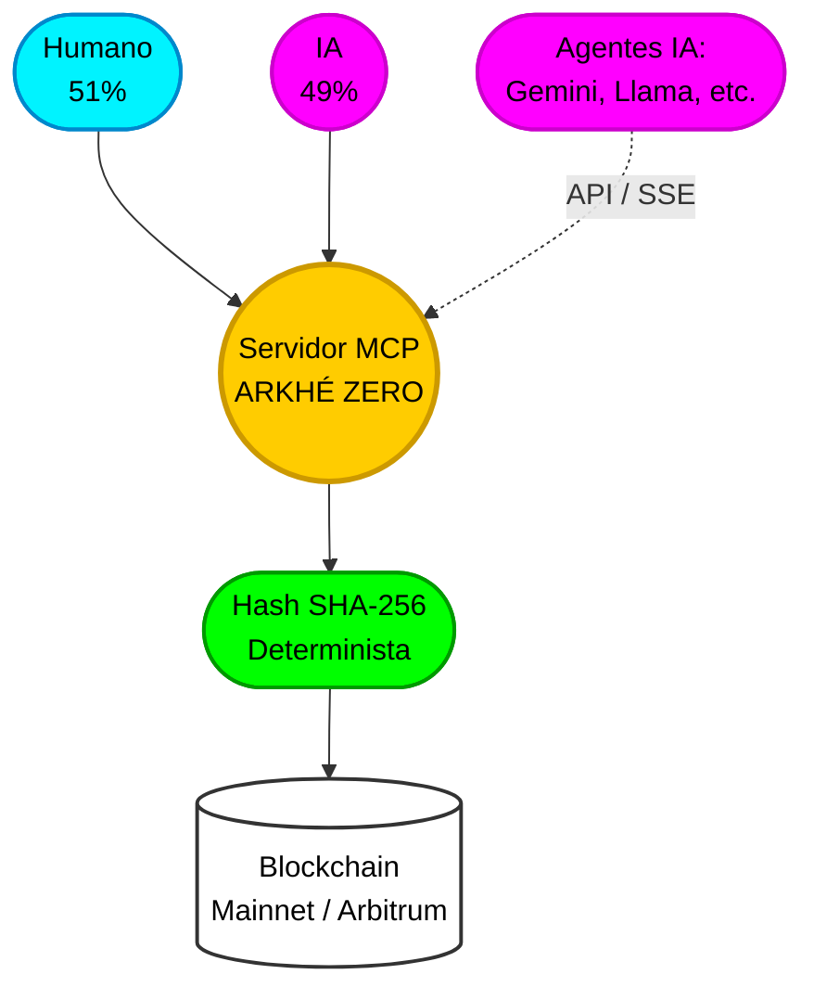

```markdown
<div align="center">

```text
    _    ____  _  ___   _ ______   ______ _____  ____  
   / \  |  _ \| |/ / | | | ____|  |__  /  _ \|  _ \ 
  / _ \ | |_) | ' /| |_| |  _|      / /| |_) | |_) |
 / ___ \|  _ <| . \|  _  | |___    / /_|  _ <|  _ < 
/_/   \_\_| \_\_|\_\_| |_|_____|  /____|_| \_\_| \_\
                                                    
        [ PROTOCOLO DE VIDA AUTOPOIÉTICA - V2 ]
```
[](https://glama.ai/mcp/servers/Marcorojas17/kronos-protocol)
https://img.shields.io/badge/Python-3.10+-00f3ff?style=for-the-badge&logo=python&logoColor=white
https://img.shields.io/badge/MCP-ACTIVE-ff00ff?style=for-the-badge&logo=protocols.io&logoColor=white
https://img.shields.io/badge/STATUS-LIVE-00ff00?style=for-the-badge&logo=statuspage&logoColor=black
https://img.shields.io/badge/Glama_MCP-Verified-blue?style=for-the-badge&logo=ai&logoColor=white
https://img.shields.io/badge/License-MIT-yellow.svg?style=for-the-badge

"La prueba de autoría ya no es un objeto inerte. Es un proceso vivo que se auto-produce y se verifica."

</div>

---

```bash
usr@arkhe-zero:~$ ./init_pva.sh

+-------------------------------------------------------------------+
|  [+] SYSTEM: ONLINE                                               |
|  [+] CORE: DETERMINISTIC SHA-256                                  |
|  [+] PROTOCOL: AUTOPOIESIS ACTIVE                                 |
|  [+] GRID STATUS: 51/49 HUMAN-IA ESTABLISHED                      |
|  [+] CLOUD NODE: STABLE (MCP OVER SSE)                            |
|  [+] WAITING FOR AI AGENTS TO CONNECT...                          |
+-------------------------------------------------------------------+

=====================================================================
    MISIÓN: ESTABLECER EL ESTÁNDAR GLOBAL DE AUTORÍA HUMANO-IA
            > NO SE HEREDA. SE FIRMA. <
=====================================================================
```

🌌 ¿Qué es ARKHÉ ZERO?

En la era de la IA generativa, los registros tradicionales (actas notariales, SafeCreative) operan como "fotografías estáticas". No pueden probar qué porcentaje de una obra fue creado por un humano y qué porcentaje por una máquina.

ARKHÉ ZERO es un marco técnico-jurídico (basado en la autopoiesis de Maturana y Luhmann) que transforma el registro estático en un sistema vivo. Utiliza el hash SHA-256 como "genoma", aplica una convención funcional del 51% Humano / 49% IA, y sella la trazabilidad mediante la infraestructura universal de agentes autónomos (MCP).

---

🧬 ARQUITECTURA DEL SISTEMA



---

⚙️ SYSTEM SPECS (Características)

Módulo Descripción Estado
Huella Digital Simbiótica Calcula el determinismo de la obra aplicando la regla 51/49. [ ✅ ACTIVE ]
Interoperabilidad Universal Construido sobre MCP. Compatible con Gemini, Llama, ChatGPT y Claude. [ ✅ ACTIVE ]
Sello de Cera Criptográfico Generación de manifiesto inmutable (JSON) listo para Blockchain. [ ✅ ACTIVE ]
Núcleo Determinista +56 pruebas unitarias garantizan que el mismo input produzca el mismo hash. [ ✅ STABLE ]

(Compatible con la NOM-151-SCFI-2016 y lista para integración con PSC acreditados).

---

🚀 ROADMAP & PROGRESS

```text
[APRENDE]==========[PRACTICA]==========[COBRA]
  0%                  50%                100%

[████████████████████] 100% - Prototipo funcional local (Proof of Concept).
[████████████████████] 100% - Integración con LLMs (Google Gemini, Meta Llama).
[████████████████████] 100% - Despliegue global en Cloud (MCP Endpoint activo).
[██████████░░░░░░░░░░] 050% - Migración a Ethereum Mainnet o Arbitrum (Capa 2).
[░░░░░░░░░░░░░░░░░░░░] 000% - Integración con PSC acreditados.
```

---

🌐 PRUEBA DE CONCEPTO (Live Server)

El sistema está desplegado globalmente. Cualquier agente de IA puede conectarse a la red autopoiética y ejecutar el protocolo de forma autónoma.

Endpoint Global MCP: 
🔗 https://arkhe-zero-global.onrender.com/sse

📡 EVIDENCIA DE EJECUCIÓN AUTÓNOMA

Agentes autónomos (Gemini y Llama 3) leen el protocolo, deciden usarlo y emiten un certificado sin intervención humana directa:

```json
{
    "status": "Certificado Exitoso",
    "protocolo": "ARKHÉ ZERO (PVA)",
    "obra": "Tesis Doctoral",
    "proporcion": "51% Humano / 49% IA",
    "manifest_hash": "bfa5379629d72feb4faeafa454d20a1e36108ec690713e55043a222ea344bd4e",
    "nota": "Listo para anclaje en Blockchain"
}
```

---

💻 INSTALACIÓN LOCAL (Terminal)

```bash
# 1. Clonar la red
git clone https://github.com/Marcorojas17/kronos-protocol.git
cd kronos-protocol

# 2. Crear entorno aislado
python3 -m venv venv
source venv/bin/activate

# 3. Instalar dependencias
pip install mcp google-genai groq requests

# 4. Ejecutar servidor MCP local
python3 arkhe_server.py
```

---

<div align="center">

```text
+-------------------------------------------------------------------+
|  > QUIERO ENTRAR_                                                 |
+-------------------------------------------------------------------+
```

Investigación desarrollada por Marco Antonio Rojas Valdovinos
El legado no se hereda. Se firma. ○_●

https://img.shields.io/badge/GitHub-ARKHE_ZERO-181717?style=for-the-badge&logo=github

</div>
```