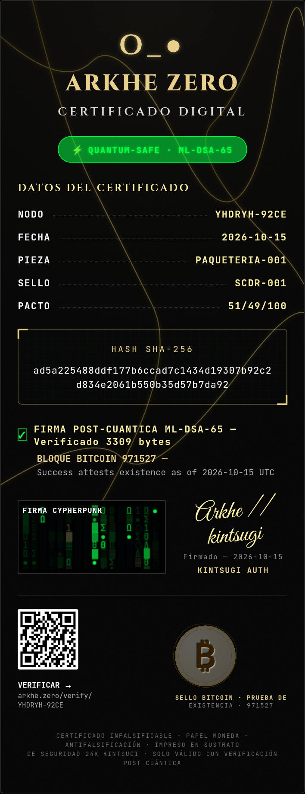

# ARKHE ZERO - Certificación Tesis en Bitcoin
### NO IA | SELLO BLOCKCHAIN | TOLUCA

> **Manifest:** `e8d9eac8` | **PVA:** `800b02b6` | **KRONOS:** =27054

## 🔐 ¿Te acusan de usar ChatGPT en tu tesis?

Te entrego certificado con sello de 840 bytes en la Blockchain de Bitcoin, verificable en opentimestamps.org

**NO generamos con IA. Certificamos que TU trabajo NO es IA.**

### INCLUYE:
- ✅ Sello Bitcoin (4 calendarios)
- ✅ Verificación OpenTimestamps
- ✅ Entrega 15 min
- ✅ Válido UAEMex / Empresas

### 💳 PAGAR AHORA:
- **1 Documento:** https://mpago.la/2zAw6Dg ($199 MXN)
- **Pack 3 Docs:** https://mpago.la/2Y8qkCR ($499 MXN)

### 📄 Ver Certificado Offline:
[ARKHE_ZERO_Certificado_Offline.html](./ARKHE_ZERO_Certificado_Offline.html)

### 🔗 Pruebas Reales:
- Commit: `1da713b OTS BTC SELLADO 840 bytes`
- Repo: `Marcorojas17/kronos-protocol`

### 📍 Toluca - Estado de México
Contacto: GitHub Issues

---
#Tesis #UAEMex #Toluca #Bitcoin #NoIA #ARKHEZERO
