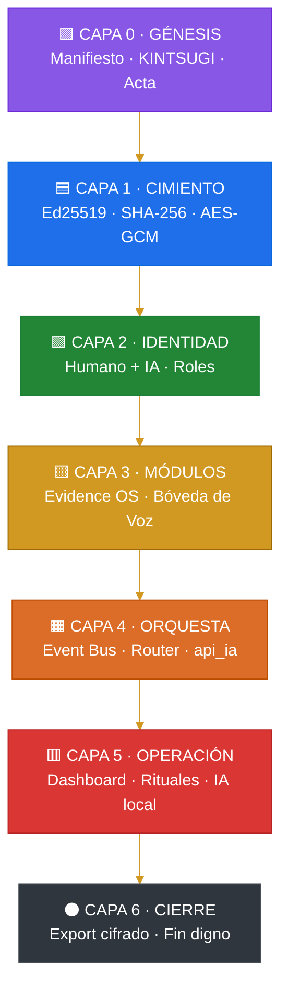
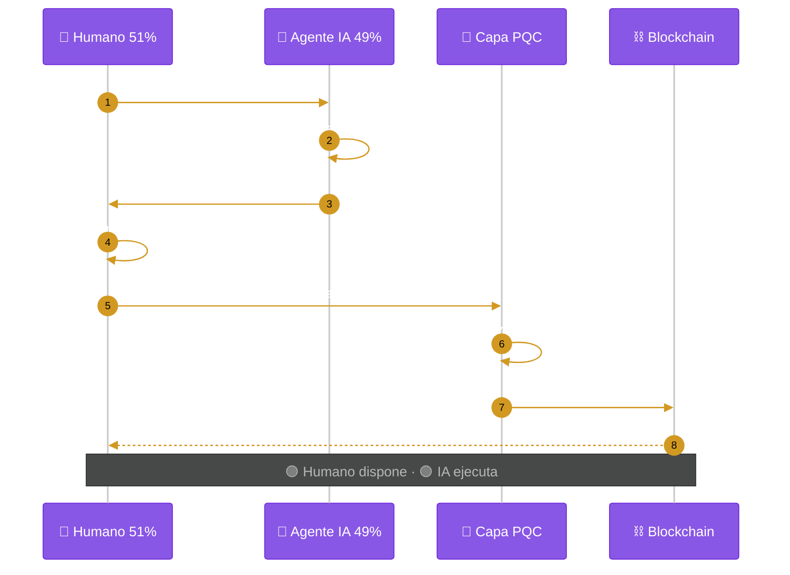
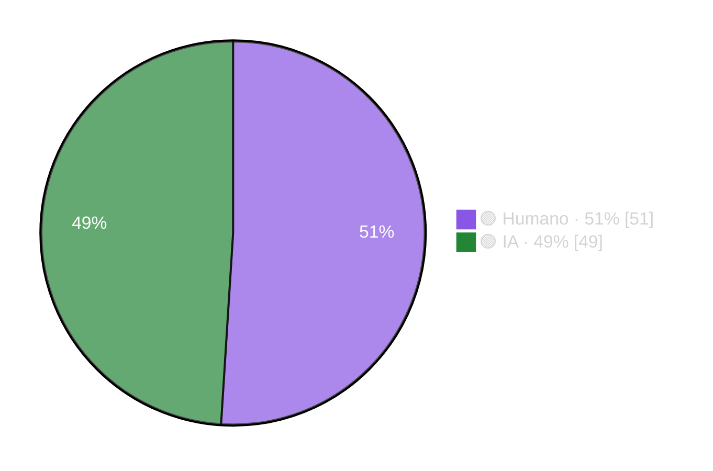
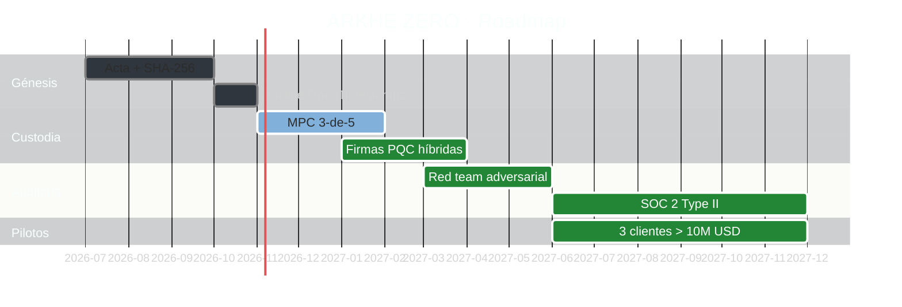
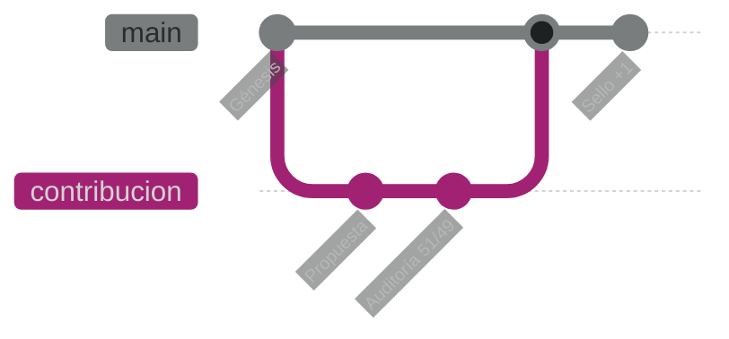

```text
    █████╗ ██████╗ ██╗  ██╗██╗  ██╗███████╗    ███████╗███████╗██████╗  ██████╗
   ██╔══██╗██╔══██╗██║ ██╔╝██║  ██║██╔════╝    ╚══███╔╝██╔════╝██╔══██╗██╔═══██╗
   ███████║██████╔╝█████╔╝ ███████║█████╗        ███╔╝ █████╗  ██████╔╝██║   ██║
   ██╔══██║██╔══██╗██╔═██╗ ██╔══██║██╔══╝       ███╔╝  ██╔══╝  ██╔══██╗██║   ██║
   ██║  ██║██║  ██║██║  ██╗██║  ██║███████╗    ███████╗███████╗██║  ██║╚██████╔╝
   ╚═╝  ╚═╝╚═╝  ╚═╝╚═╝  ╚═╝╚═╝  ╚═╝╚══════╝    ╚══════╝╚══════╝╚═╝  ╚═╝ ╚═════╝
```

<div align="center">

```text
                       ◯                 ◯
                      ╱ ╲               ╱ ╲
                     ╱   ╲             ╱   ╲
                    ╱     ╲           ╱     ╲
                   ◯───────╲         ╱───────◯
                    ╲       ╲       ╱       ╱
                     ╲       ╲     ╱       ╱
                      ╲       ✕   ╱       ╱
                     ╱       ╱ ╲ ╲       ╲
                    ╱       ╱   ╲ ╲       ╲
                   ◯───────╱     ╲───────◯
                    ╲     ╱       ╲     ╱
                     ╲   ╱         ╲   ╱
                      ╲ ╱           ╲ ╱
                       ◯             ◯

              ═══════  S I G I L O   Z E R O  ═══════

              🟣   51% HUMANO  ·  49% IA   🟢
              ⚫   100% REAL  ·  KINTSUGI   🟡

              NODO  YHDRYH-92CE  ·  SELLO  SCDR-001
```

### **"El legado no se hereda. Se firma."**

[](#-tests)
[](#-criptografía-post-cuántica)
[](#-demo-en-vivo)
[](#-por-qué-existe)
[](#-licencia)

[🇪🇸 Español](#) · [🇬🇧 English](README.en.md) · [🌐 Demo](https://marcorojas17.github.io/kronos-protocol) · [📖 Docs](docs/) · [🔐 SELLO](SELLO.md)

</div>

---

## ⚡ En 30 segundos

| 🎯 | Prueba | Tecnología | Color |
|:--:|:-------|:-----------|:-----:|
| 🕐 | Que un documento existía en una fecha | SHA-256 + TSA | 🟦 |
| ✍️ | Quién lo firmó (humano + IA) | ML-DSA-87 | 🟪 |
| 🔒 | Que no ha sido alterado | Bitcoin + Ethereum | 🟩 |
| ☁️ | Sin nube, sin OpenAI, sin AWS | Local-first | 🟨 |
| 💳 | Sin cuentas, sin tarjeta, sin permisos | Autónomo | 🟧 |

---

## 🎯 Por qué existe

> 🟥 **El 60% del legado cultural digital de LATAM se pierde** porque preservarlo cuesta ~$20 USD/mes y requiere internet estable.
>
> Un artista en Toluca no puede pagar Adobe, Dropbox y OpenAI.
>
> 🟩 Pero tiene un celular. Y ese celular puede correr Llama 3.2.
>
> **→ ARKHÉ ZERO es la alternativa local-first.**

---

## 🏛 Arquitectura · 6 capas



---

## ✍️ Flujo de firma · quién decide qué



---

## 🏛 Pacto 51 / 49



```text
      ┌──────────────┐       ┌──────────────┐       ┌──────────────┐
      │     51%      │       │     49%      │       │     100%     │
      │    HUMANO    │       │      IA      │       │     REAL     │
      ├──────────────┤       ├──────────────┤       ├──────────────┤
      │ Firma final  │       │  Custodia    │       │ Verificable  │
      │ Veto absoluto│       │  Ejecución   │       │ Auditable    │
      │ Decide       │       │  Continúa    │       │ Irrepetible  │
      └───────┬──────┘       └───────┬──────┘       └───────┬──────┘
              ╲                     │                     ╱
               ╲                    │                    ╱
                ╲                   ▼                   ╱
                 ╲        ┌──────────────────┐         ╱
                  ╲       │  EL LEGADO VIVE  │        ╱
                   ╲      │  MÁS ALLÁ DEL    │       ╱
                    ╲     │  AUTOR HUMANO    │      ╱
                     ╲    └──────────────────┘     ╱
                      ╲                           ╱
                       ╲_________________________╱
                        ◯_●  ·  ■_□  ·  100% REAL
```

---

## 🔐 Criptografía post-cuántica

| Algoritmo | Estándar | Función | Estado |
|:----------|:---------|:--------|:------:|
| 🟪 **ML-KEM-1024** | FIPS 203 | Encapsulamiento de claves | ✅ Spec |
| 🟦 **ML-DSA-87** | FIPS 204 | Firmas digitales | ✅ Spec |
| 🟩 **SLH-DSA-SHAKE-256s** | FIPS 205 | Firmas larga duración | ✅ Spec |
| 🟨 **Ed25519** | RFC 8032 | Firma transitoria | ✅ Activo |
| 🟧 **SHA-256 / SHA-3** | NIST | Integridad | ✅ Activo |
| 🔴 ~~RSA~~ | — | Prohibido | ❌ |
| 🔴 ~~ECDSA~~ | — | Prohibido | ❌ |
| 🔴 ~~MD5 / SHA-1~~ | — | Prohibido | ❌ |

---

## 📦 Qué contiene

| | Carpeta | Descripción |
|:-:|:--------|:------------|
| 🟪 | `ia/` | Servidor MCP · IA local · memoria persistente |
| 🟦 | `docs/` | Ciudad Digital · 158 artículos |
| 🟩 | `src/kronos360/` | Librería criptográfica · 56 tests |
| 🟨 | `tests/` | Suite completa · 100% passing |
| 🟧 | `certificacion/` | Notario · Sello · Verificador |
| 🟥 | `gobernanza/` | Propuestas · Quórum · Revocación |
| ⚫ | `identidad/` | Registro humano · IA · Roles |
| 🟣 | `movimiento/` | Comunidad · Rituales · Onboarding |
| 🟢 | `pva/` | Antecedente: Vida Autopoiética |
| 🟡 | `atribucion/` | Trazabilidad agentes · EU AI Act |

**Total:** 2287 archivos · 24 secciones · 40 MB

---

## 🧪 Tests


```bash
$ python3 -m pytest tests/*.py -v

tests/test_api.py .................... 16 passed
tests/test_audit_log.py ...............  9 passed
tests/test_guard.py .................. 14 passed
tests/test_hashing.py .................  3 passed
tests/test_keyfile.py .................  7 passed
tests/test_signatures.py ..............  7 passed

═══════════════════════════════════════════════
🟢 56 passed in 4.43s
═══════════════════════════════════════════════
```

---

## 🔱 El Índice Cero

```text
╔══════════════════════════════════════════════════════════════════════════╗
║                                                                          ║
║   🟪  Obra génesis:  KRONOS — Arquitectura de Legado Digital             ║
║                                                                          ║
╠══════════════════════════════════════════════════════════════════════════╣
║                                                                          ║
║   🟦  Safe Creative      2607146379465                                   ║
║   🟩  Co-creatividad     2607086319439                                   ║
║   🟨  Fecha génesis      14 jul 2026 · 00:46:01 UTC                      ║
║                                                                          ║
╚══════════════════════════════════════════════════════════════════════════╝
```

> 🔐 **Hash SHA-256, tx Ethereum y sello eIDAS:** se publican en [`SELLO.md`](SELLO.md) una vez verificados por terceros. Este README no afirma lo que no se puede comprobar.

---

## 🗺 Roadmap



---

## 📖 Documentación

| | Documento | Archivo |
|:-:|:----------|:--------|
| 🟪 | Manifiesto | [`MANIFIESTO-VIRAL.md`](MANIFIESTO-VIRAL.md) |
| 🟦 | KINTSUGI | [`KINTSUGI.md`](KINTSUGI.md) |
| 🟩 | Gobernanza | [`GOVERNANCE.md`](GOVERNANCE.md) |
| 🟨 | Arquitectura | [`ARCHITECTURE.md`](ARCHITECTURE.md) |
| 🟧 | Glosario | [`GLOSSARY.md`](GLOSSARY.md) |
| 🟥 | Roadmap | [`ROADMAP.md`](ROADMAP.md) |
| ⚫ | Protocolo KTP-001 | [`PROTOCOL.md`](PROTOCOL.md) |
| 🟣 | Ciudad Digital | [`docs/CIUDAD/`](docs/CIUDAD/) |
| 🟢 | Local-First | [`local-first.html`](local-first.html) |
| 🟡 | Sello Génesis | [`SELLO.md`](SELLO.md) |

---

## 🤝 Contribuir



Regla principal: **toda contribución respeta el pacto 51/49.**
Lee [`CONTRIBUTING.md`](CONTRIBUTING.md) y [`CODE_OF_CONDUCT.md`](CODE_OF_CONDUCT.md).

---

## ⚖️ Licencia

| | Componente | Licencia |
|:-:|:-----------|:---------|
| 🟩 | Código | Apache 2.0 + MIT |
| 🟦 | Contenido | CC BY-NC-ND 4.0 |
| 🟪 | Sistema | LGU · Licencia Global Única |
| 🟨 | Marca | ARKHÉ ZERO · KINTSUGI |

---

```text
╔══════════════════════════════════════════════════════════════════════════╗
║                                                                          ║
║                                                                          ║
║                              ◯─────◯                                     ║
║                            ╱         ╲                                   ║
║                          ╱             ╲                                 ║
║                        ◯                 ◯                               ║
║                         ╲               ╱                                ║
║                          ╲             ╱                                 ║
║                            ╲    ✕    ╱                                   ║
║                          ╱             ╲                                 ║
║                         ╱               ╲                                ║
║                        ◯                 ◯                               ║
║                          ╲             ╱                                 ║
║                            ╲         ╱                                   ║
║                              ◯─────◯                                     ║
║                                                                          ║
║                                                                          ║
║                  "El legado no se hereda. Se firma."                     ║
║                                                                          ║
║                                                                          ║
║                  Marco Antonio Rojas Valdovinos                          ║
║                  Toluca · Estado de México · 2026                        ║
║                                                                          ║
║                                                                          ║
║                  NODO  YHDRYH-92CE   ·   Sello  SCDR-001                 ║
║                                                                          ║
║                                                                          ║
║                     ◯_●   ·   51 / 49 / 100   ·   ■_□                    ║
║                                                                          ║
║                                                                          ║
╚══════════════════════════════════════════════════════════════════════════╝
```